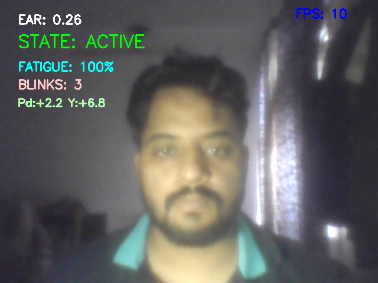

# 🚗 Rule-Based Driver Monitoring System

A real-time, rule-based driver drowsiness and distraction detection system built with Python, MediaPipe, and OpenCV. It monitors eye activity, gaze direction, and head pose via webcam and plays audio alerts when unsafe behaviour is detected.

---

## Demo

> **No screenshot is committed yet.** To add one: run `python main.py`, press **`s`** (or use a screen-capture tool) while the overlay is visible, save the file as `docs/demo.png`, and replace this block:
>
> ```
> 
> ```

---

## Features

- **Drowsiness Detection** — Eye Aspect Ratio (EAR) with exponential moving average smoothing; alerts after eyes remain closed for > 1.5 s
- **Gaze Tracking** — Iris landmark ratio detects LEFT / RIGHT gaze; ignores rapid scanning (turn-mode)
- **Head Pose Detection** — Nose-to-eye distance with hysteresis to detect head-down events
- **Fatigue Score** — 0–100 live score that decays on alerts and recovers on attentive driving
- **Blink Counter** — Counts blinks per 30 s window; high blink rate contributes to fatigue
- **Audio Alerts** — Priority-based audio queue (pygame) — DROWSY > DOWN > LEFT/RIGHT
- **Event Logger** — Every alert is timestamped and appended to `fatigue_log.csv`
- **Auto Calibration** — First 60 frames calibrate EAR threshold and head baseline per driver

---

## Project Structure

```
.
├── main.py          # Main loop — capture, detection, UI
├── detection.py     # EAR, gaze ratio, head pose calculations
├── state.py         # Alert state machine with stability filter
├── audio.py         # Priority audio playback via pygame
├── config.py        # All tuneable parameters
├── logger.py        # CSV event logger
└── sounds/
    ├── drowsy.mp3
    ├── left.mp3
    ├── right.mp3
    └── down.mp3
```

---

## Requirements

- Python 3.8+
- Webcam

Install dependencies:

```bash
pip install opencv-python mediapipe pygame numpy
```

---

## Usage

```bash
python main.py
```

- Hold still and look straight ahead during the **60-frame calibration** phase.
- Press **`q`** to quit.

---

## On-Screen Display

| Overlay | Description |
|---|---|
| `STATE` | Current driver state: ACTIVE / DROWSY / LEFT / RIGHT / DOWN |
| `EAR` | Smoothed Eye Aspect Ratio |
| `FATIGUE` | Live fatigue score (100 = fully alert, 0 = critical) |
| `INATTENTIVE` | Seconds since last ACTIVE state |
| `BLINKS` | Blink count in the current 30 s window |
| `FPS` | Frames per second |

---

## Configuration

All parameters are in [`config.py`](config.py):

| Parameter | Default | Description |
|---|---|---|
| `CALIB_FRAMES` | `60` | Frames used for per-driver calibration |
| `EAR_EMA_ALPHA` | `0.4` | EAR smoothing factor (higher = more reactive) |
| `EAR_FACTOR` | `0.80` | EAR threshold multiplier (lower = more sensitive) |
| `GAZE_HOLD_TIME` | `1.4` | Seconds of sustained gaze before alert |
| `COOLDOWN` | `4` | Minimum seconds between repeated alerts |

---

## How It Works

```
Webcam Frame
    │
    ▼
MediaPipe Face Mesh (468 + 10 iris landmarks)
    │
    ├── EAR  ──► Drowsiness check  ──┐
    ├── Gaze ──► Distraction check ──┼──► State Machine ──► Audio Alert
    └── Head ──► Head-down check  ──┘         │
                                              ▼
                                       fatigue_log.csv
```

### Eye Aspect Ratio (EAR)

```
EAR = (||p2−p6|| + ||p3−p5||) / (2 × ||p1−p4||)
```

A smoothed EAR below `mean_calibration_EAR × EAR_FACTOR` for more than 1.5 s triggers a **DROWSY** alert.

### Gaze Ratio

Iris centre X position is normalised between the inner and outer eye corners. Values > 0.60 → LEFT, < 0.40 → RIGHT. Rapid alternation (≥ 2 switches in 1.5 s) activates **turn mode** and suppresses alerts.

### Head Pose

Vertical distance between nose tip and eye midpoint. Hysteresis thresholds (enter at +0.08, exit at +0.05 above baseline) prevent flickering.

---

## Event Log

All alerts are appended to `fatigue_log.csv`:

```
2025-01-15 09:32:11.423, DROWSY
2025-01-15 09:32:45.801, DOWN
```

---

## License

MIT
