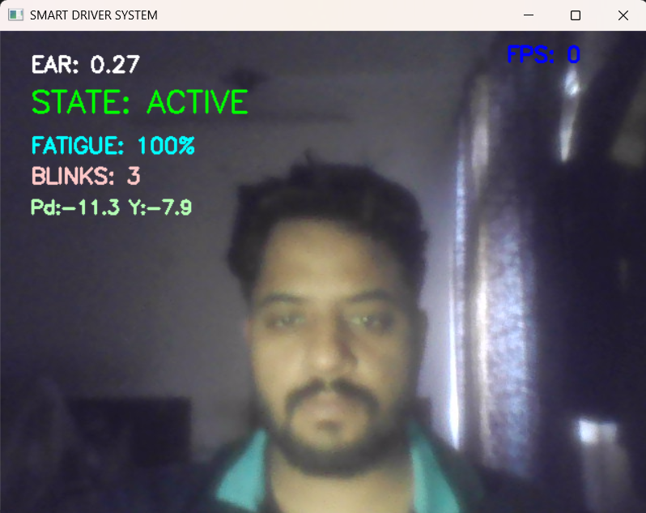
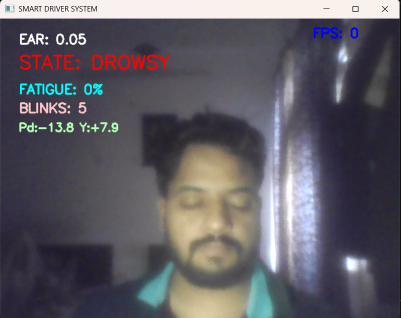
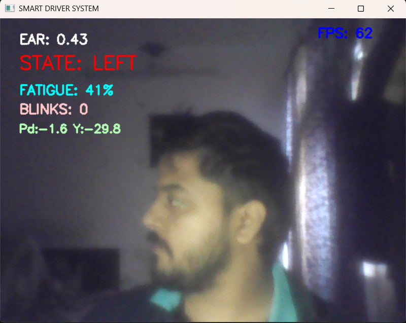
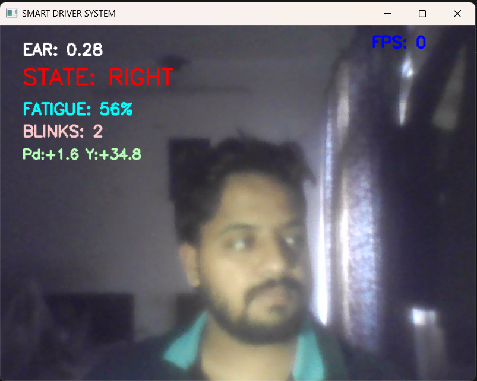
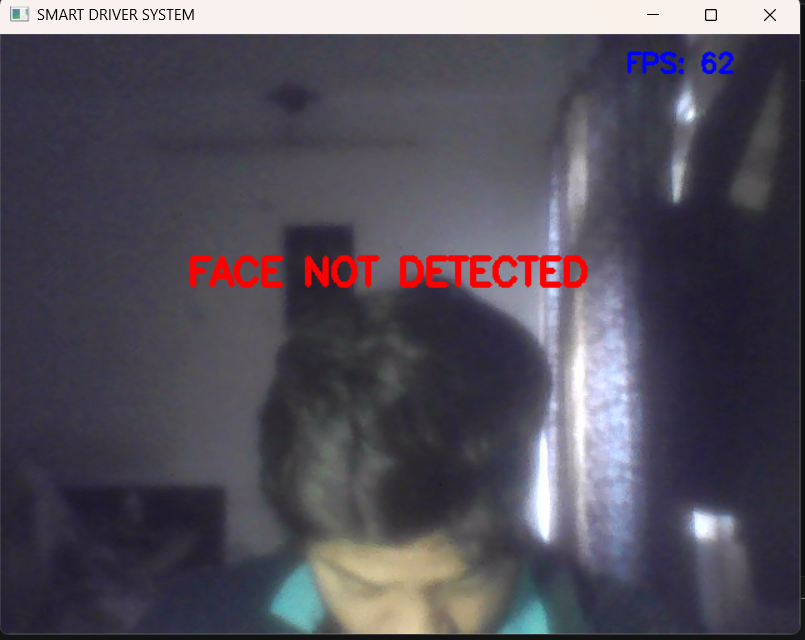

# Rule-Based Driver Monitoring System

 

A real-time driver drowsiness and distraction detector built with Python, MediaPipe and OpenCV. It reads a webcam stream, tracks eye closure, gaze direction and head pose, and plays an audio alert on prolonged eye closure, sustained sideways gaze or a head-down posture. The detection logic is rule-based (thresholds and timers applied to MediaPipe landmarks); MediaPipe Face Mesh is the only learned component.

> **Status:** research prototype, evaluated so far on one subject with simulated events (see [Limitations](#limitations)). It is not a safety device and must not be relied on while driving.

---

## Demo

Screenshots captured from the live webcam loop:

| ACTIVE | DROWSY |
|:---:|:---:|
|  |  |
| EAR 0.27 · alertness 100 % | EAR 0.05 · alertness 0 % — eyes closed |

| LEFT gaze | RIGHT gaze | Face not detected |
|:---:|:---:|:---:|
|  |  |  |
| Yaw −29.8° | Yaw +34.8° | Head fully down or out of frame; overlay only, no alert |

The on-screen `FATIGUE` value is the **alertness** score: 100 % means fully alert (see [On-Screen Display](#on-screen-display)).

---

## Features

- **Drowsiness detection** — Eye Aspect Ratio (EAR) with frame-rate-independent smoothing; DROWSY when the eyes stay closed for more than 1.5 s.
- **Gaze tracking** — iris position between the eye corners gives LEFT / RIGHT; rapid left-right scanning (shoulder checks) enables a "turn mode" that suppresses these alerts.
- **Head-pose detection** — pitch and yaw from `cv2.solvePnP`; DOWN is raised when pitch exceeds the calibrated neutral by more than 15° and clears at 10° (hysteresis).
- **Alertness score** — live 0–100 score (100 = fully alert) that drops during alert states and recovers while the driver is attentive.
- **Blink counter** — blinks per 30 s window; a high blink rate lowers the alertness score.
- **Audio alerts** — priority-based playback (DROWSY > DOWN > LEFT/RIGHT) with a cooldown between repeated alerts.
- **Event log** — every alert is appended to `logs/fatigue_log.csv` together with the numeric features at that moment.
- **Per-driver calibration** — the first 60 frames set the EAR threshold and the neutral head pitch.
- **Testable design** — one `DriverMonitor` class serves both the live loop and the offline evaluation scripts; time is injected by the caller, so the whole pipeline can be run on synthetic landmarks in unit tests.

---

## How It Works

```
Webcam frame
   │
   ▼
landmark_adapter.py        mirror + brightness boost, then MediaPipe Face Mesh
   │                       (468 face + 10 iris landmarks)
   ▼
DriverMonitor.process_landmarks(lm, t)                          monitor.py
   ├─ EAR ────────► eyes closed longer than ear_hold_s ────► DROWSY
   ├─ Head pose ──► pitch above neutral by head_enter_deg ─► DOWN
   └─ Iris gaze ──► off-centre longer than gaze_hold_s ────► LEFT / RIGHT
   │
   ▼  one state per frame (DROWSY > DOWN > LEFT/RIGHT > ACTIVE)
StateManager                                                    state.py
   │  debounce + cooldowns
   ├──► audio alert                                             audio.py
   └──► logs/fatigue_log.csv                                    logger.py
```

### Eye Aspect Ratio (EAR)

```
EAR = (‖p2 − p6‖ + ‖p3 − p5‖) / (2 · ‖p1 − p4‖)
```

EAR (Soukupová & Čech, 2016) is computed in pixel space for both eyes and averaged, then smoothed with an exponential moving average whose time constant (`tau_ear_s`) keeps the smoothing independent of frame rate. At the end of calibration the threshold is set to `mean(calibration EAR) × ear_factor`. A frame counts as "eyes closed" when the smoothed EAR is below `threshold × ear_blink_multiplier` (1.1, so 0.88 × the calibrated mean with the defaults). Eyes closed for more than `ear_hold_s` (1.5 s) trigger **DROWSY**; while the condition lasts, the alert repeats every `cooldown_drowsy_s`.

### Gaze

Each iris centre is normalised between its own eye's corners; the two ratios are averaged and smoothed (`tau_gaze_s`). A ratio of 0.5 is centred; above 0.60 means **LEFT**, below 0.40 means **RIGHT**. The offset must last `gaze_hold_s` (1.4 s) before an alert is raised. Two or more rapid direction switches within 1.5 s enable turn mode, which suppresses LEFT/RIGHT alerts.

### Head pose

`get_head_pose()` runs `cv2.solvePnP` on six face-mesh landmarks against a generic 3D face model and an approximate pinhole camera (focal length ≈ the larger image dimension, no camera calibration). It returns pitch and yaw in degrees (+pitch = head down, +yaw = driver's right). The pitch averaged during calibration is the neutral baseline. **DOWN** starts when pitch exceeds that baseline by more than `head_enter_deg` (15°) and ends when it falls back to `head_exit_deg` (10°) or less; the gap between the two prevents flicker. Yaw is shown on screen; it only influences gaze alerts if the ablation flag `use_yaw_for_gaze` is switched on (default: off).

### State machine and alerts

A non-ACTIVE state must persist for `stability_duration_s` (0.167 s) before it can alert. `StateManager` then limits repeats with `cooldown_drowsy_s` (2 s) for DROWSY and `cooldown_other_s` (4 s) for LEFT, RIGHT and DOWN. Playback uses a single channel with priorities: a higher-priority sound interrupts a lower one, never the reverse.

### Alertness score

The score starts at 100 and is clamped to 0–100. It falls by 60 points/s while DROWSY and by 30 points/s while LEFT, RIGHT or DOWN; it falls a further 6 points/s when more than 20 blinks were counted in the current 30 s window; it recovers by 15 points/s while ACTIVE. All rates are per second, so behaviour does not depend on frame rate. The score is a hand-designed heuristic, not a physiological measurement. Internally it is called `fatigue_score`.

---

## Project Structure

```
.
├── main.py                 # Live webcam loop: capture, overlay, key handling (I/O only)
├── monitor.py              # DriverMonitor.process_landmarks(lm, t, w, h) -> FrameResult: the whole pipeline
├── detection.py            # EAR, iris gaze ratio, solvePnP head pose
├── landmark_adapter.py     # Frame -> MediaPipe landmarks; shared by the live loop and scripts/extract.py
├── state.py                # StateManager: debounce and alert cooldowns
├── audio.py                # Priority-based alert playback (pygame); silent NullAudio for tests
├── logger.py               # CSV event logger
├── config.py               # Frozen Config dataclass: every tunable, with its unit
├── sounds/                 # Alert sounds, one per state (.ogg, .wav or .mp3)
├── tests/                  # Headless pytest suite
├── scripts/                # record_clip.py, extract.py, evaluate.py, smoke_check.py
├── evaluation/             # metrics.py, splits.csv
├── docs/                   # Screenshots, EVALUATION.md (protocol and results), PLAN.md
├── .github/workflows/      # ci.yml: ruff + pytest
├── CHANGELOG.md            # Behaviour-changing commits, with before/after
├── agents.md               # Contributor quick-start
├── requirements.txt        # Pinned, verified dependency set
├── requirements-lock.txt   # Full transitive pins
├── pyproject.toml          # Python version, ruff and pytest settings
└── LICENSE                 # MIT
```

`logs/` is created at runtime by the event logger.

---

## Requirements and Installation

- **Python 3.10, verified on Windows x64.** `pyproject.toml` declares `>=3.10`; the verified interpreter is 3.10.11, and other platforms and versions have not been tested.
- A webcam (the app opens device 0).
- Pinned dependencies are in [`requirements.txt`](requirements.txt): `mediapipe==0.10.9`, `opencv-contrib-python==4.10.0.84`, `numpy==1.26.4`, `pygame==2.6.1`, `matplotlib==3.10.9`. A lock file with full transitive pins is in [`requirements-lock.txt`](requirements-lock.txt).

```bash
git clone https://github.com/Dev252001/Driver-Monitoring-System.git
cd Driver-Monitoring-System
python -m venv venv
venv\Scripts\activate
pip install -r requirements.txt
python scripts/smoke_check.py    # optional: runs the MediaPipe landmark adapter on a black frame
```

Install only `opencv-contrib-python`; do not add `opencv-python` alongside it.

---

## Usage

```bash
python main.py
```

1. Hold still and look straight ahead while the first 60 frames with a detected face are collected (calibration, about 2 s at 30 FPS). The overlay shows `STATE: CALIBRATING` and no alerts are raised during this phase.
2. After calibration the monitor runs and plays an alert when it detects DROWSY, LEFT, RIGHT or DOWN.
3. Press `q` to quit, or `s` to save a screenshot to `docs/demo.png`.

---

## On-Screen Display

| Overlay | Description |
|---|---|
| `STATE` | `CALIBRATING`, `ACTIVE`, `DROWSY`, `LEFT`, `RIGHT` or `DOWN` |
| `EAR` | Smoothed Eye Aspect Ratio |
| `FATIGUE` | **Alertness score**: 100 % = fully alert, 0 % = critical. The label is a leftover from earlier versions |
| `BLINKS` | Blinks counted in the current 30 s window |
| `Pd` / `Y` | Head pitch relative to the calibrated neutral, and head yaw, in degrees |
| `FPS` | Frames per second |
| `FACE NOT DETECTED` | No face found in the frame; no alert is raised in this case |

---

## Configuration

Every tunable lives in [`config.py`](config.py) as a frozen `Config` dataclass (singleton `CFG`), and each field is documented with its unit. The main parameters:

| Parameter | Default | Description |
|---|---|---|
| `calib_frames` | 60 | Frames used for per-driver calibration |
| `ear_factor` | 0.80 | Threshold = calibrated mean EAR × factor (higher = more sensitive) |
| `tau_ear_s` | 0.0653 | EAR smoothing time constant (seconds) |
| `ear_hold_s` | 1.5 | Seconds of closed eyes before DROWSY |
| `gaze_hold_s` | 1.4 | Seconds of sustained gaze before alert |
| `head_enter_deg` / `head_exit_deg` | 15 / 10 | Head-down hysteresis (degrees) |
| `cooldown_drowsy_s` / `cooldown_other_s` | 2.0 / 4.0 | Minimum seconds between repeated alerts |

Further parameters (`ear_blink_multiplier`, the gaze thresholds, the alertness-score rates and the ablation flags such as `ema_enabled` and `use_yaw_for_gaze`) are documented in `config.py`.

---

## Event Log

Each alert (DROWSY, LEFT, RIGHT, DOWN) is appended to `logs/fatigue_log.csv`. The file is created next to `logger.py`, independent of the working directory, and a header row is written when it is new.

| Column | Description |
|---|---|
| `iso_utc_time` | ISO-8601 UTC timestamp of the alert |
| `session_id` | Identifier supplied by the caller (`unknown` in the live loop for now) |
| `state` | `DROWSY`, `LEFT`, `RIGHT` or `DOWN` |
| `ear` | Smoothed EAR at alert time (4 decimals) |
| `ear_threshold` | EAR threshold in use at alert time (4 decimals) |
| `fatigue_score` | Alertness score 0–100 at alert time (1 decimal; 100 = fully alert) |
| `fps` | Frame rate at alert time (1 decimal); `nan` when the caller does not supply it, as in the live loop for now |

First lines of a real log:

```csv
iso_utc_time,session_id,state,ear,ear_threshold,fatigue_score,fps
<row 2: paste from your own logs/fatigue_log.csv>
<row 3: paste from your own logs/fatigue_log.csv>
```

**Privacy:** the live app does not record video, and the log contains numeric features only. A single frame is saved only if you press `s`. `scripts/record_clip.py`, used for evaluation, records video only when you run it explicitly.

---

## Testing

The unit tests are headless: they need no webcam, display or audio device, and no test imports `cv2`, `mediapipe` or `pygame` at collection time. Audio and logging backends are injected (`NullAudio`, an `EventLogger` with a temporary path) and the caller supplies the timestamps, so the full pipeline can be driven with synthetic landmarks.

```bash
pip install ruff pytest
python -m ruff check .
python -m pytest tests/ -v
python scripts/smoke_check.py
```

- `scripts/smoke_check.py` runs the real MediaPipe landmark adapter on a black frame, so it needs the dependencies from `requirements.txt` but no face and no webcam.
- `tests/test_adapter_smoke.py` is the pytest version of that check; it skips itself when MediaPipe is not installed.
- **CI:** [`ci.yml`](.github/workflows/ci.yml) runs `ruff` and `pytest` on every push and pull request to `main` and `polish/**` (Python 3.10, Ubuntu).
- **Offline evaluation:** `scripts/record_clip.py` records a cued clip, `scripts/extract.py` turns the video into a landmark file, and `scripts/evaluate.py` replays it through the same `DriverMonitor` and computes event-level and frame-level metrics (`evaluation/metrics.py`). The protocol, commands and results are in [`docs/EVALUATION.md`](docs/EVALUATION.md).

---

## Limitations

This is a prototype. Each point below can be checked against the code or against [`docs/EVALUATION.md`](docs/EVALUATION.md).

- **Weak preliminary results.** The only offline evaluation uses one subject, two sessions and one laptop webcam, with *simulated* events (the subject closes their eyes or looks away on cue), not real drowsiness. With the default thresholds, the held-out session (S01_2) gave 0/3 DROWSY, 1/6 LEFT, 0/6 RIGHT and 0/3 DOWN events detected, and 10–20 false alarms per minute of neutral (no-event) time across the two sessions. The numbers are published unadjusted and do not show that the detector works for other people, cameras or lighting.
- **Provisional thresholds.** The head-pose thresholds (15° / 10°) are marked provisional in `config.py`. The gaze thresholds (0.40 / 0.60) are unchanged since before the iris-pairing fix and have not been re-derived. No threshold tuning has been applied to the reported results.
- **No alert when the face is lost.** If MediaPipe finds no face (for example, head fully down or out of frame), the overlay shows `FACE NOT DETECTED`, but no sound is played and nothing is logged.
- **Simple rules.** Drowsiness is a 1.5 s EAR hold, not PERCLOS or a learned model. Calibration runs once at start-up, with no re-calibration while running. Only the first detected face is used. Head pose relies on a generic 3D face model and an approximate camera matrix, and no per-camera angle-error measurement is documented.
- **Heuristic alertness score.** Its decay and recovery rates are fixed constants carried over from the original per-frame values.
- **Platform coverage.** The webcam pipeline has only been run on Windows x64 with Python 3.10.11. CI covers the headless tests only, so the MediaPipe, OpenCV and audio paths are not exercised there. No in-vehicle testing is documented.
- **Logging gaps.** In live runs the log's `session_id` is `unknown` and `fps` is `nan`, because the live loop does not pass them to the logger yet.

---

## Possible Next Steps

These follow directly from the limitations above.

- Record more subjects and sessions, then run the threshold sweeps described in `docs/EVALUATION.md`.
- Re-derive the gaze thresholds now that the iris pairing is fixed.
- Raise an alert (or at least log an event) when the face is lost for several seconds.
- Pass `session_id` and `fps` through to the event log.

---

## Development Notes

This project was built with the assistance of an AI coding assistant (IBM Bob). The author reviewed the logic, thresholds and architecture; the thresholds have not been validated on real-driver data (see [Limitations](#limitations)). Every behaviour-changing fix is recorded with its before/after behaviour in [`CHANGELOG.md`](CHANGELOG.md).

---

## License

MIT, see [`LICENSE`](LICENSE). Author: [@Dev252001](https://github.com/Dev252001).
